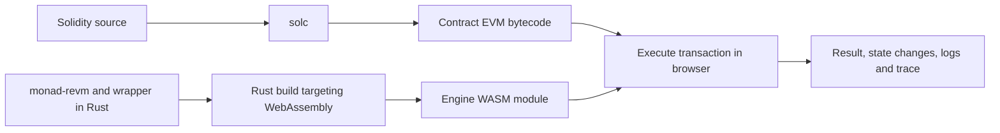
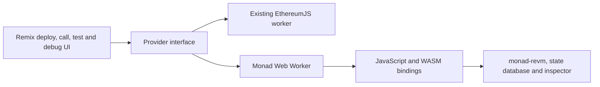

# Monad support in Remix through Rust and WebAssembly

Add a local Monad execution environment to Remix using `monad-revm` compiled to WebAssembly. Preserve the existing EthereumJS environments and place the Monad implementation behind Remix's provider interface. Monad execution rules remain in Rust; the TypeScript integration handles requests, browser lifecycle, and presentation.

The architecture is agreed. Implementation is organized into the five work areas below. The initial release targets a local development VM, followed by RPC forking and historical execution.

## Source baseline

Use the `main` branch of `category-labs/monad-revm` for all analysis and integration work. Select a commit from that branch for reproducible package builds and advance it deliberately with regression checks. Feature branches are not the integration baseline.

The baseline reviewed on 21 October 2026 is:

| Repository | Branch | Commit |
| --- | --- | --- |
| `category-labs/monad-revm` | `main` | `eee0ba8ddb7c5f432d8cfb999d558502a7ae491c` |
| `remix-project-org/remix-project` | `master` | `2f321f833a` |

The separate `remix-ide` repository holds user documentation. Implementation changes belong in `remix-project`. The first wrapper lives at `libs/remix-monad/wasm` and depends on the pinned engine revision, leaving the `monad-revm` main checkout unchanged.

This Monad baseline already includes MIP-7 and MIP-18 under `MonadNext`. `MonadTen` remains the default, and `MonadNext` has no scheduled activation. Keep the selected execution specification explicit and distinguish experimental behavior in the environment selector.

## How execution fits together

A contract and its execution engine are two different programs.

- Solidity is compiled by solc into EVM bytecode and associated ABI, source maps, and compiler metadata.
- EthereumJS implements the EVM in TypeScript, delivered to the browser as JavaScript.
- REVM implements the EVM in Rust. `monad-revm` extends that implementation with Monad rules.
- Rust can compile the engine into WebAssembly, which browsers execute through their built-in WebAssembly runtime.

The contract continues to contain EVM instructions such as `SSTORE`, `CALL`, and Monad extensions. The WebAssembly module contains the implementation that interprets those instructions, charges gas, and updates simulated state. The contract itself does not need to be translated into WebAssembly.

In the existing local VM, `@ethereumjs/evm` executes instructions, `@ethereumjs/vm` handles transaction and block execution, and supporting packages provide state, transaction types, and hardfork configuration. Remix adds its provider, accounts, history, debugger integration, and persistence.

The proposed browser package contains a WASM binary, JavaScript loading and binding code, and TypeScript declarations. `wasm-bindgen` can generate much of the language bridge. The wrapper must still define a stable API and map execution results into useful types. A package tool such as `wasm-pack` can assist with building and packaging; it does not implement the provider or debugger.

Use `wasm32-unknown-unknown` for the browser target. The successful feasibility build uses the library's existing `no_std` configuration and pure Rust crypto backends. `no_std` avoids depending on the usual Rust standard library; allocation through `alloc` remains available. It is a useful dependency configuration here, not a universal requirement for compiling Rust to WASM.

WASI provides operating-system-style host interfaces for WASM programs. The local execution engine demonstrated here requires no WASI runtime or browser WASI shim. Browser persistence and networking can be supplied by the surrounding JavaScript integration when needed.

## Architecture and ownership

A Web Worker runs execution away from the UI thread. Requests and responses cross the worker boundary through messages. Requests can look like JSON-RPC even when no HTTP server or network connection is involved.

| Responsibility | Owner |
| --- | --- |
| Solidity compilation, ABI and source maps | Existing compiler integration |
| Monad opcode, gas, memory and precompile behavior | `monad-revm` |
| Local account, code and storage state | Rust wrapper and database |
| Execution inspection | Rust inspector |
| Provider request and response compatibility | TypeScript adapter |
| Environment selection, contract UI and debugger display | Remix |
| Browser persistence and optional remote RPC fetching | Browser integration |

Use coarse calls across the JavaScript/WASM boundary: execute or simulate a transaction, read state, export a snapshot, or retrieve a trace. Avoid a JavaScript callback for every instruction or storage access. Represent 256-bit values as bytes or exact strings at the boundary, rather than JavaScript numbers.

The existing worker entry is [worker-vm.ts](../apps/remix-ide/src/blockchain/providers/worker-vm.ts). The current [transaction runner](../libs/remix-lib/src/execution/txRunnerVM.ts) calls EthereumJS directly, so backend selection requires a Monad provider implementation, not just a different constructor argument.

## Area 1 Rust and WASM integration package

Build a small wrapper around `monad-revm` with a stable interface suitable for browser use.

Scope:

- Own a persistent in-memory database and explicit transaction, block, chain, and hardfork configuration.
- Expose transaction execution with commit and simulation without commit, state reads, account initialization, reset, and snapshot export/import.
- Define result and error types, including success, revert, exceptional halt, validation error, return data, logs, state changes, and gas accounting.
- Expose optional inspection and bounded trace retrieval.
- Produce a browser package with a WASM asset, loader, bindings, and TypeScript declarations.
- Preserve `memory_limit` when disabling default features. Select and test the pure Rust crypto backends.
- Pin the source revision, dependencies, toolchain, and binding-tool versions for reproducible releases.

Keep the wrapper's external types independent of REVM's internal generic types. Hide version-specific construction and result conversion behind this API.

Completion criteria: the same fixtures produce matching execution results and state changes in native Rust and browser WASM; create, call, revert, hardfork gating, and representative precompiles work. Package initialization and errors work inside a Web Worker.

## Area 2 Monad provider and local blockchain state

Connect the wrapper to Remix's existing provider contract and local VM workflows.

Scope:

- Implement the required account, transaction, call, estimation, balance, nonce, code, storage, block, receipt, and log methods.
- Support Remix's simulator extensions for execution results, call identifiers, console logs, and state export.
- Maintain local block and transaction history and the chain context required by Monad reserve-balance rules.
- Add a Monad environment with explicit specification selection, currency and chain configuration, funded development accounts, reset, and error handling.
- Give saved Monad state a versioned format and identify its backend and specification.
- Preserve the EthereumJS environments and continue using common transaction or encoding utilities where appropriate.

Gas accounting must follow the current `main` implementation. `ExecutionResult::tx_gas_used()` reports the full transaction gas limit for receipts; `result.gas().total_gas_spent()` reports consumption including intrinsic gas for estimation and profiling. Do not estimate a transaction by reading its receipt charge.

The existing [estimator](../libs/remix-simulator/src/methods/transactions.ts) uses a 16,777,216 gas cap and a 15 percent buffer. Monad's configured cap is 30 million, and excess submitted gas carries a real fee cost. Choose and validate a Monad estimation policy that accounts for these differences.

Completion criteria: a Solidity contract can be deployed, called, transacted with, and inspected through Remix. Calls and estimation do not commit state. Receipts, logs, balances, reset, and save/restore behave consistently.

## Area 3 Debugger and extension instruction support

Adapt Rust inspection output to Remix's debugger and teach the debugger how to decode Monad instructions.

Scope:

- Produce compatible step records with bytecode PC, opcode name, gas, depth, stack, memory, and errors.
- Preserve the expected before-instruction timing and normalize depth and value representations.
- Support storage inspection before and after transactions, storage ranges, and hash preimages needed to decode mappings.
- Preserve nested call, delegatecall, creation, return, revert, and precompile behavior in traces.
- Extend bytecode decoding, instruction indexing, symbolic stack effects, and fork detection.
- Validate source-map alignment for multi-byte extension instructions.
- Bound trace memory and transfer volume; support optional or deferred trace capture and explicit truncation reporting.
- Prefer a shared or generated opcode metadata definition for names, lengths, stack effects, and activation.

The current [VmProxy](../libs/remix-simulator/src/VmProxy.ts) gathers trace and state data through EthereumJS events. [codeUtils.ts](../libs/remix-debug/src/code/codeUtils.ts) independently decodes using EthereumJS opcode tables. Both responsibilities need coverage.

For example, `AE 00` is one `CALLSTACKDEPTH` operation under `MonadNext`. Treating it as separate `INVALID` and `STOP` instructions would break debugger indexing. MIP-7 still preserves ordinary EVM jump-destination analysis, including the special case of a `JUMPDEST` after the extension prefix.

Completion criteria: forward/backward trace navigation, source highlighting, stack and memory views, nested calls, and storage variables are correct for representative Solidity and extension examples. Ethereum environments retain their existing decoding.

## Area 4 Compiler and development tools

Make Monad execution accessible through compilation, deployment, testing, and editor workflows.

Scope:

- Keep the compiler's EVM target compatible with the selected Monad specification.
- Use raw bytecode or standalone Yul `verbatim` for initial extension examples.
- Evaluate a suitable custom compiler build if native Solidity/Yul syntax for Monad extensions is required.
- Validate compiler source maps against the debugger's instruction model.
- Route IDE Solidity unit tests and the `remix-tests` CLI to the selected backend.
- Add examples, environment descriptions, and test coverage for stable and experimental specifications.

Remix can already load custom compiler URLs. A new execution backend does not itself add new compiler builtins, optimizer knowledge, or editor completions. Developing a compiler fork is a separate scope decision.

Completion criteria: ordinary Solidity workflows and unit tests use the correct Monad backend. An extension example compiles through the chosen path, executes under the correct specification, and has an explicitly validated debugging experience.

## Area 5 RPC forking and historical execution

Extend local execution to use state from a fixed remote block and to replay transactions with the correct historical environment.

Scope:

- Fetch and cache accounts, code, storage, and block hashes against a pinned block reference.
- Bridge asynchronous browser RPC calls to REVM's synchronous database interface.
- Evaluate fetching missing state and retrying from a clean checkpoint; ensure retries do not commit partial execution or duplicate logs.
- Populate block and transaction context, including parent/grandparent senders and authorities used by reserve-balance decisions.
- Resolve the historical Monad specification from chain and timestamp.
- Define supported historical storage/debug requests and provider capability requirements.
- Persist fork metadata and distinguish fetched state from local changes.

The default Monad chain context contains no historical metadata. Filling account storage alone is insufficient for canonical historical behavior. Staking lifecycle simulation also requires explicit epoch and system-call inputs when those behaviors are in scope.

Completion criteria: selected historical transactions match a trusted reference for outcome, state changes, logs, and gas accounting. Fork snapshots are repeatable, missing data produces actionable errors, and simulation never broadcasts a transaction.

## Validation and delivery sequence

The first local slice is implemented in [remix-monad](../libs/remix-monad/README.md): a Rust/WASM package, Monad Ten and experimental Monad Next environments, local provider state, and debugger support for `CALLSTACKDEPTH` and `CALLERN`. [MonadDemo.sol](../libs/remix-monad/examples/MonadDemo.sol) exercises ordinary Solidity deployment and storage, then a nested raw-bytecode extension call. Native and WASM integration tests cover this path; broader conformance, development-tool routing and remote forking remain follow-up work. This does not complete every criterion in Areas 1–4.

A standalone feasibility probe built from the `main` revision above passed 22 checks in Node and in a browser Web Worker: 11 scenarios, each with and without inspection. Scenarios covered ordinary execution, contract creation, storage writes and rollback, MIP-18 at root and nested call depth, hardfork gating, and KZG/SHA256 precompiles. The probe checked results and selected inspection behavior; it did not validate Remix's complete trace format.

That probe had no host imports and measured 1,142,404 bytes, or 350,298 bytes gzipped. Those measurements describe the probe, not the eventual package or a performance benchmark.

The first implementation milestone should exercise Areas 1–3 together: deploy an ordinary contract, execute a small extension example, and step through both in Remix. Then complete local provider behavior and persistence, integrate development tools, and add remote forking.

| Milestone | Rough effort for one engineer familiar with Rust and Remix |
| --- | --- |
| Vertical slice with a packaged engine and basic Remix execution | 3–5 working days |
| Usable local VM with accounts, receipts, logs and basic tests | 2–4 weeks total |
| Dependable local integration with debugger, persistence and regression coverage | 6–10 weeks total |
| Remote forking and historical fidelity | Additional 3–6 weeks |

These estimates exclude developing a compiler fork and full-node functionality. The target is a local development simulator; consensus and the production parallel execution scheduler are outside the initial scope.

Regression coverage should compare native and WASM execution, exercise existing Monad execution fixtures, verify precompile backend parity, test hardfork boundaries, and cover browser loading and representative Remix workflows. Existing library limitations remain relevant: this baseline's staking `addValidator` skips signature verification and uses simplified key-derived addresses.

## Lessons from REVM issue 79

[REVM issue 79](https://github.com/bluealloy/revm/issues/79), opened in March 2022, requests JavaScript bindings and specifically mentions Remix.

The thread distinguishes a usable binding package from an engine that can compile to WASM. The maintainer [declined full support in September 2022](https://github.com/bluealloy/revm/issues/79#issuecomment-1238762981), then [confirmed in January 2024](https://github.com/bluealloy/revm/issues/79#issuecomment-1912468920) that REVM can run as WASM and needs a wrapper integrating with JavaScript and `wasm-bindgen`.

The earlier `revmjs` link is historical. The npm registry reports only version 0.1.0, published on 2 November 2021, and the linked `crates/revmjs` path is absent from the current REVM repository. Treat it as background rather than a dependency for the current REVM 43-based integration.

The practical consequence is to maintain a focused Monad wrapper with its own browser tests and release process. The thread supports this architecture; it does not supply the provider, persistence, or debugger integration.

## References

- [Monad source baseline](https://github.com/category-labs/monad-revm/tree/eee0ba8ddb7c5f432d8cfb999d558502a7ae491c)
- [EthereumJS VM architecture](https://github.com/ethereumjs/ethereumjs-monorepo/tree/master/packages/vm)
- [Rust browser WASM target](https://doc.rust-lang.org/rustc/platform-support/wasm32-unknown-unknown.html)
- [JavaScript and Rust bindings](https://wasm-bindgen.github.io/wasm-bindgen/introduction.html)
- [WebAssembly concepts](https://developer.mozilla.org/en-US/docs/WebAssembly/Guides/Concepts)
- [Yul verbatim](https://docs.soliditylang.org/en/latest/yul.html#verbatim)
- [MIP-7](https://github.com/monad-crypto/MIPs/blob/main/MIPs/MIP-7.md)
- [MIP-18](https://github.com/monad-crypto/MIPs/blob/main/MIPs/MIP-18.md)
- [revmjs package metadata](https://registry.npmjs.org/revmjs)
